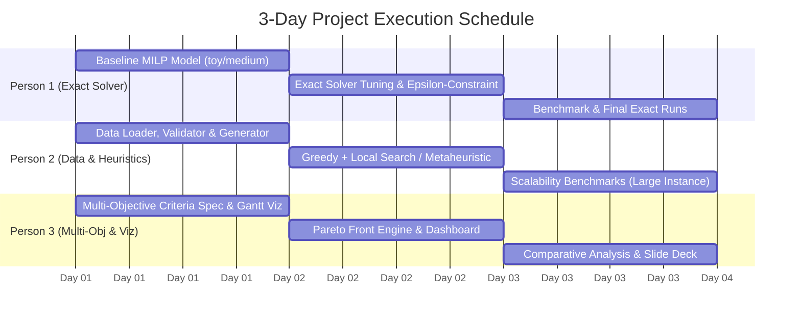

# Project Execution Plan: Staffing Collaborators on Projects

**Target Timeline:** 3 Days  
**Team Composition:** 3 Team Members  
**Goal:** Deliver an exact and heuristic optimization engine, an instance generator, multi-objective Pareto front exploration, rich visualizations (decision space & objective space), and defense slides.

---

## 1. Required Tools & Skills to Master

Before and during Day 1, each member should familiarize themselves with these specific tools:

| Category | Tools | Purpose | Who Needs It |
| :--- | :--- | :--- | :--- |
| **Exact Solvers** | `gurobipy` or `ortools.linear_solver` / `ortools.sat` | Formulate and solve the MILP / CP-SAT models | Person 1, Person 3 |
| **Heuristics / Search** | Python (`numpy`, `random`, `scipy`) | Greedy constructive heuristic, Simulated Annealing or Genetic Algorithm | Person 2 |
| **Data & Architecture** | `json`, `dataclasses` / `pydantic` | Clean data parsing, validation, and instance generation | Person 2 |
| **Multi-Objective** | $\epsilon$-constraint method, Weighted-sum | Generating non-dominated Pareto sets | Person 1, Person 3 |
| **Visualization** | `matplotlib`, `seaborn`, `plotly` | Plotting Pareto fronts and interactive Gantt charts (decision space) | Person 3 |
| **Version Control** | `git`, GitHub | Collaborative branch management, clean PRs, commit history | All 3 Members |

---

## 2. Critical Pitfalls & Things to Take Care Of

Keep these technical and mathematical considerations in mind throughout development:

1. **Sparsity & Variable Filtering (Critical for Scaling):**
   - The variable count is $|S| \times |J| \times |Q| \times |H|$. For large instances, declaring all combinations will exhaust memory.
   - **Do not create $X_{i,j,k,t}$** for tuples where $k \notin \mathcal{Q}_i^S$ or $k \notin \mathcal{Q}_j^J$, or where $t \in \mathcal{V}_i^S$. Filter them out during variable creation.
2. **Handling Uncompleted Projects ($Y_j = 0$) in Delay Penalties:**
   - In the slide formulation:
     $$X_{i,j,k,t} \times t \le E_j \quad \text{and} \quad E_j - d_j \le L_j$$
   - If a project is *not* completed ($Y_j = 0$), ensure that $L_j$ does not incur penalty $c_j$ if some days were worked or if $E_j$ is default-initialized.
   - Ensure either:
     $$E_j \le h \cdot Y_j \quad \text{and} \quad L_j \le h \cdot Y_j$$
     or linking $L_j \ge E_j - d_j - h \cdot (1 - Y_j)$ and $L_j \ge 0$.
3. **Multi-Objective Method Choice:**
   - Simple weighted-sum cannot find non-dominated points in non-convex regions of the Pareto front.
   - Use the **$\epsilon$-constraint method**: optimize Profit subject to $\text{Makespan} \le \epsilon$, stepping $\epsilon$ across feasible values.
4. **Independent Solution Validator:**
   - Always write an independent `validate_solution(instance, solution)` function that verifies all 7 constraints without solver libraries. This prevents false positive "optimal" solutions.
5. **Instance Generator Realism:**
   - Generated instances must have balanced skill supplies and project demands; otherwise, instances may either be trivial or completely over-constrained.

---

## 3. Team Member Roles

- **Person 1 (P1) — Exact Modeling & Solver Specialist:**
  - Owns MILP / CP-SAT formulation, mathematical correctness, solver configuration, and exact Pareto front generation.
- **Person 2 (P2) — Data Engineering, Instance Generator & Heuristics:**
  - Owns data loading, solution validation, instance generator, and fast heuristic/metaheuristic algorithms for large instances.
- **Person 3 (P3) — Multi-Objective Analysis, Visualization & Reporting:**
  - Owns multi-objective evaluation criteria, Pareto front plotting, Gantt chart scheduling visualization, and final defense slides.

---

## 4. 3-Day Step-by-Step Schedule

---

### Day 1: Foundations, Baseline Model & Data Pipeline

#### Morning (Sync & Setup - 1.5h together)
- Initialize Git repository and project directory structure.
- Agree on JSON data structures, solution format, and coding standards.
- Set up Python virtual environment (`gurobipy`, `ortools`, `matplotlib`, `plotly`, `pandas`).

#### Afternoon (Individual Core Tasks)
- **Person 1 (Exact Model):**
  - Implement `exact_solver.py` with Gurobi or OR-Tools CP-SAT.
  - Implement all 7 constraints from [PROJECT_SPECIFICATIONS.md](PROJECT_SPECIFICATIONS.md).
  - Test and verify on `toy_instance.json`. Confirm optimal objective value.
- **Person 2 (Data Loader, Validator & Generator):**
  - Implement `data_loader.py` to ingest any instance JSON cleanly into Python dataclasses.
  - Implement `solution_validator.py` to check all 7 constraints and compute net profit independently.
  - Draft `instance_generator.py` with parameterized horizon, staff count, skill distributions, and job lists.
- **Person 3 (Visualization & Objective Definitions):**
  - Implement `visualization.py`: write a Gantt chart generator (staff on Y-axis, time horizon on X-axis, colored by project).
  - Formalize secondary objective functions:
    - $f_2$: Total makespan / completion time $\max_j E_j$.
    - $f_3$: Staff multitasking (number of project switches).
    - $f_4$: Number of delayed projects $\sum_j \mathbb{I}(L_j > 0)$.

#### Evening Checkpoint (End of Day 1)
- Solution from Person 1 for `toy_instance.json` passes Person 2's validator.
- Person 3 renders the first Gantt chart of the toy solution.

---

### Day 2: Heuristics, Multi-Objective Front & Large Instances

#### Morning
- **Person 1:**
  - Run exact solver on `medium_instance.json`. Benchmark runtime.
  - Implement $\epsilon$-constraint method to produce multi-objective Pareto front between Profit and Makespan.
- **Person 2:**
  - Finalize `instance_generator.py` and produce test instances of small, medium, and large scales.
  - Begin implementing `heuristic_solver.py`:
    - Phase 1: Greedy constructive heuristic (prioritizing high gain-to-effort projects).
- **Person 3:**
  - Build `pareto_visualizer.py` to display 2D and 3D Pareto fronts in objective space.
  - Add interactive tooltips (showing which projects were completed at each Pareto point).

#### Afternoon
- **Person 1:**
  - Tune MILP solver parameters (time limits, MIPGap, warm-start from Person 2's heuristic).
  - Test if exact solver can find feasible solutions for `large_instance.json` within a 5-minute timeout.
- **Person 2:**
  - Implement Phase 2 of `heuristic_solver.py`: Local Search (neighborhood moves: reassign day, swap staff, drop/add project) or Simulated Annealing.
  - Validate heuristic outputs against `solution_validator.py`.
- **Person 3:**
  - Connect Person 1's exact Pareto front and Person 2's heuristic non-dominated front onto the same plot to compare approximation quality.
  - Generate decision-space comparison views (Gantt charts comparing profit-maximizing vs makespan-minimizing schedules).

#### Evening Checkpoint (End of Day 2)
- Pareto front generated for toy and medium instances.
- Heuristic delivers valid solutions on `large_instance.json` in under 10 seconds.
- Multi-objective visualizer operational.

---

### Day 3: Benchmarking, Synthesis, Slides & Defense Preparation

#### Morning
- **Person 1:**
  - Run comprehensive computational experiments across all instances (toy, medium, large, generated).
  - Record execution time, optimality gaps, number of variables, and constraints.
- **Person 2:**
  - Run heuristic benchmarks on the same instances.
  - Calculate gap between heuristic solution and exact/best-bound solutions.
  - Stress-test the instance generator on edge cases (dense schedules, vacation overlaps).
- **Person 3:**
  - Assemble all plots: Pareto front curves, runtime vs. instance size charts, and Gantt charts.
  - Draft the presentation slide deck (introduction, mathematical model, solver architecture, experimental results, and conclusion).

#### Afternoon
- **All Team Members (Co-working):**
  - Consolidate slides:
    - Slide 1: Title, Team, Context (CompuOpti & Margaux Dourtille).
    - Slide 2: Problem Definition & Constraints.
    - Slide 3: Mathematical Model (Variables, Objective, Key Constraints).
    - Slide 4: Multi-Objective Extensions & $\epsilon$-Constraint Approach.
    - Slide 5: Resolution Approaches (Exact vs. Heuristics).
    - Slide 6: Experimental Results & Benchmarks (Toy, Medium, Large, Generated).
    - Slide 7: Non-Dominated Solutions (Objective Space) & Gantt Visualization (Decision Space).
    - Slide 8: Key Insights, Managerial Recommendations for CEO, Future Work.
  - Clean and document code: ensure `README.md` has clear instructions to run all scripts.
  - Perform a dry-run presentation defense (15–20 minutes) with Q&A practice.

---

## 5. Daily Checklist & Deliverables Matrix

| Day | Person 1 Deliverable | Person 2 Deliverable | Person 3 Deliverable |
| :--- | :--- | :--- | :--- |
| **Day 1** | Working exact MILP solver for `toy_instance.json` | Data loader, solution validator, and initial instance generator | Gantt chart generator & multi-objective criteria spec |
| **Day 2** | $\epsilon$-constraint Pareto solver & medium instance runs | Fast heuristic / metaheuristic for large instances | Pareto front visualizer & comparative objective plots |
| **Day 3** | Benchmark tables (exact gap/runtime) | Scalability analysis & final generator stress tests | Final slide deck & decision/objective space visualizations |
